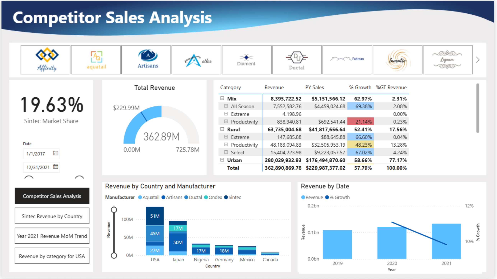

# Competitor Sales Analysis

A two-page Power BI report comparing revenue performance by manufacturer, country, category, product, and time.

## Dashboard preview

## Business questions
How much revenue was generated? How has performance changed relative to the previous year? Which categories, locations, and products contribute most to sales?

## Report pages
| Page | Focus | Screenshot |
|---|---|---|
| Competitor Sales Analysis | Revenue, growth, market share, country/manufacturer comparisons | [View](./screenshots/sales-overview.png) |
| Advanced Insights | Decomposition Tree, Key Influencers and category/segment drilldowns | [View](./screenshots/advanced-insights.png) |

## Key observations from the exported report
- **Total revenue: $362.89M**.
- **Prior-year sales: $229.99M**, with **57.79% growth** displayed.
- **947K units** are reported on the Advanced Insights page.
- **Sintec market share: 19.63%** under the report's visible selection.
- The **Urban** category contributes approximately **$280.03M**, the largest category in the decomposition tree.
- The country/manufacturer comparison shows the **USA** as a leading revenue market in the displayed view.
- The Key Influencers visual identifies specific products associated with increased average revenue; these are model-generated associations, not proof of causal impact.

## Business recommendations
- Explore the Urban category's strongest segments and products to understand its revenue contribution.
- Compare revenue growth and market share across manufacturers and countries to identify competitive opportunities.
- Use the Decomposition Tree and Key Influencers as starting points for deeper investigation, then validate findings with underlying data.

## Tools & features
Power BI · DAX · KPI cards · Matrix visuals · Interactive filters · Decomposition Tree · Key Influencers

## Original report
[Open the Power BI file](./Competitor%20Sales%20Analysis.pbix) in Power BI Desktop.

> Figures reflect the supplied PDF export and may be affected by filters and selected dates. Verify dataset redistribution rights before publication.
