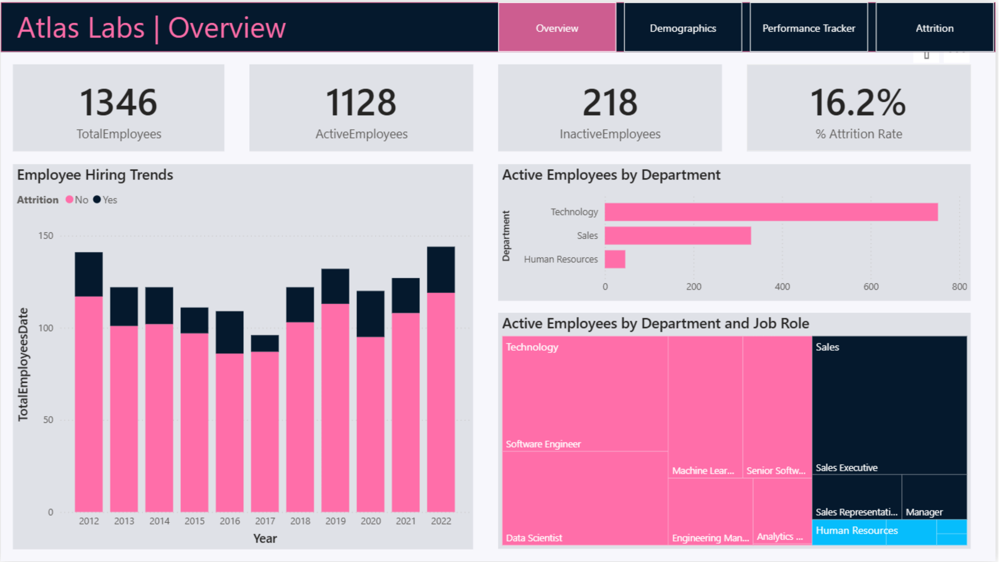

# HR Analytics

A four-page Power BI report exploring workforce size, demographics, employee performance, and attrition.

## Dashboard preview

## Business questions
How is the workforce distributed? Which employee groups have higher attrition? How do satisfaction and performance measures evolve over time?

## Report pages
| Page | Focus | Screenshot |
|---|---|---|
| Overview | Workforce KPIs, hiring trends, active staff by department and job role | [View](./screenshots/overview.png) |
| Demographics | Age, gender, marital status, ethnicity and salary comparisons | [View](./screenshots/demographics.png) |
| Performance Tracker | Employee-level satisfaction, work-life balance and rating trends | [View](./screenshots/performance-tracker.png) |
| Attrition | Attrition by role, business travel, overtime and tenure | [View](./screenshots/attrition.png) |

## Key observations from the exported report
- **1,346 total employees**, including **1,128 active** and **218 inactive** employees.
- The displayed **attrition rate is 16.2%**.
- **Technology** has the largest number of active employees in the department comparison.
- The **20–29** age group is the largest age bracket shown.
- The charts suggest **higher attrition among employees who work overtime** and **frequent business travelers** than their respective comparison groups.
- The attrition-by-tenure chart shows relatively elevated rates among employees in their earliest years.

## Business recommendations
- Investigate overtime workload and frequent travel as possible retention risk indicators; these charts show associations, **not causation**.
- Prioritize retention analysis for early-tenure employees and roles with elevated attrition.
- Track satisfaction and manager ratings over time to identify areas for follow-up.

## Tools & features
Power BI · DAX · Interactive filters · KPI cards · Time-series charts · Treemaps · Employee performance tracking

## Original report
[Open the Power BI file](./HR%20Analytics.pbix) in Power BI Desktop.

> The performance screenshot has the displayed employee name redacted for portfolio sharing. Review the PBIX data for confidentiality and redistribution permissions before publishing.
